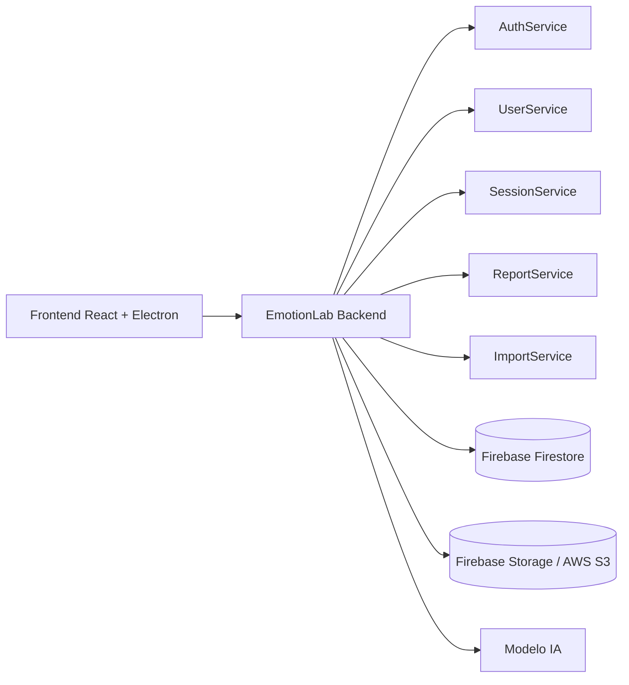

# EmotionLab Backend

Backend de EmotionLab construido con Flask para autenticación, administración de usuarios, importación de sesiones, predicción con Machine Learning y entrega de reportes.


## Resumen

- Autenticación JWT con control de acceso por roles.
- Administración de visualizadores desde endpoints dedicados.
- Dashboard, sesiones, reportes e importación para el rol visualizador.
- Integración con Firebase, AWS S3 y un modelo de predicción en Scikit-Learn.

## Arquitectura



## Estructura

```text
Emotionlab-Backend/
├── app.py
├── config/
├── core/
├── ia/
├── middleware/
├── routes/
├── services/
├── tests/
└── utils/
```

## Requisitos

| Recurso | Versión / uso |
| --- | --- |
| Python | 3.12 o superior |
| Firebase | Firestore y Storage |
| AWS | S3 para archivos |
| Modelo IA | `ia/modelo_pipeline.pkl` |

## Instalación

```bash
git clone https://github.com/EmilyGonzalezU/Emotionlab-Backend.git
cd Emotionlab-Backend
python -m venv .venv
.venv\Scripts\activate
pip install -r requirements.txt
```

En Linux o macOS:

```bash
python3 -m venv .venv
source .venv/bin/activate
pip install -r requirements.txt
```

## Variables de entorno

Crea un archivo `.env` a partir de la plantilla correspondiente y define al menos:

```env
JWT_SECRET=UnaClaveSuperSecretaDeMasDe32Caracteres
GOOGLE_APPLICATION_CREDENTIALS=credentials/firebase.json
```

## Ejecución

```bash
python app.py
```

Servidor local:

```text
http://localhost:5000
```

## Pruebas

```bash
pytest
```

Cobertura actual del proyecto:

- API
- Autenticación
- Dashboard
- Importación
- Participantes
- Predicción
- Reportes
- Parser de sesiones
- Servicio de sesiones

## Roles

### Administrador

Puede iniciar sesión, ver su perfil, cambiar su contraseña y administrar visualizadores.

No puede acceder a sesiones, participantes, dashboard clínico ni predicciones.

### Visualizador

Puede iniciar sesión, ver su perfil, cambiar su contraseña y trabajar con dashboard, sesiones y reportes.

No puede crear, editar ni eliminar usuarios.

## Endpoints

### Autenticación

| Método | Endpoint |
| --- | --- |
| POST | `/auth/login` |

### Usuarios

| Método | Endpoint | Acceso |
| --- | --- | --- |
| GET | `/users` | Admin |
| POST | `/users` | Admin |
| PUT | `/users/<uid>` | Admin |
| PATCH | `/users/<uid>/enable` | Admin |
| PATCH | `/users/<uid>/disable` | Admin |
| DELETE | `/users/<uid>` | Admin |
| GET | `/users/me` | Admin / Visualizador |
| PATCH | `/users/me/password` | Admin / Visualizador |
| GET | `/users/activity` | Admin |
| GET | `/users/<uid>/activity` | Admin |

### Dashboard

| Método | Endpoint | Acceso |
| --- | --- | --- |
| GET | `/dashboard` | Visualizador |

### Sesiones

| Método | Endpoint | Acceso |
| --- | --- | --- |
| GET | `/sessions` | Visualizador |
| GET | `/sessions/<id>` | Visualizador |

### Importación

| Método | Endpoint | Acceso |
| --- | --- | --- |
| POST | `/import/sync` | Visualizador |

### Reportes

| Método | Endpoint | Acceso |
| --- | --- | --- |
| GET | `/reports` | Visualizador |
| GET | `/reports/export` | Visualizador |

## Seguridad

- JWT para autenticación.
- Hash de contraseñas con Passlib + bcrypt.
- Control de acceso por roles.
- Variables de entorno para secretos.
- CORS para el frontend.

## Integraciones

- Firebase Firestore
- Firebase Storage
- AWS S3
- Frontend React + Electron

## Estado

Backend funcional con autenticación, administración de usuarios, importación de sesiones, predicción, reportes y dashboard.