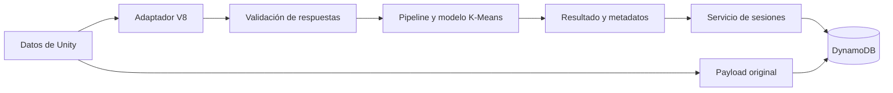

# EmotionLab Backend

API REST en Flask para la captura, análisis y consulta de experiencias EmotionLab. El backend integra autenticación con Amazon Cognito, persistencia en DynamoDB, almacenamiento de sesiones e informes en S3, envío de correo con SES y análisis local con el paquete EmotionLab V8.

## Funciones actuales

- Autenticación y gestión de usuarios mediante Cognito, con autorización por roles.
- Gestión de participantes, sesiones, capturas y seguimientos.
- Importación y consulta de datos provenientes de Unity y de la integración HTTPS con los lentes.
- Dashboards e informes de sesiones y seguimientos. Los informes PDF completos pasan por una solicitud y aprobación administrativa.
- Registro de auditoría y límites para solicitudes de códigos de sesión.
- Inferencia local con los artefactos V8 incluidos en `ia/modelo_v8/`.
- Infraestructura AWS descrita en Terraform en `infrastructure/terraform/environments/dev/`.

## Arquitectura de inferencia V8



El paquete valida sus archivos mediante `ia/modelo_v8/manifest_sha256_v1.json`. La inferencia usa las versiones fijadas en `ia/modelo_v8/requirements-inferencia.txt`; el entorno de desarrollo y la imagen de despliegue usan Python 3.13.18. En ejecución local, el modelo V8 se ejecuta dentro del backend. El cliente y contrato V2 permanecen en el código como integración heredada, pero V8 es el flujo local actual.

Los grupos K-Means son etiquetas de agrupamiento, no diagnósticos ni resultados clínicos. El índice exploratorio de tensión se guarda como pendiente de validación y sin valor calculado. El modelo es experimental y no cuenta con validación clínica independiente.

## Requisitos

- Python 3.13.18 para ejecutar el backend con inferencia V8.
- AWS configurado para los servicios utilizados por la aplicación. Las credenciales se obtienen mediante la cadena estándar de credenciales de AWS.
- Docker solo para construir la imagen de backend en contenedor.
- Terraform 1.5 o posterior para gestionar la infraestructura.
- DynamoDB Local y Java 17 o posterior si se configura persistencia local.

## Instalación y ejecución local

El proyecto fija Python 3.13.18 para que el runtime coincida con los artefactos V8. En Windows, instala Micromamba y crea el entorno con esa versión exacta:

```powershell
winget install --id Mamba.Micromamba --exact
micromamba create --yes --prefix ./.venv-v8 --channel conda-forge python=3.13.18 pip
.\.venv-v8\python.exe -m pip install -r requirements.txt
```

En macOS o Linux, crea el mismo entorno con Micromamba:

```bash
micromamba create --yes --prefix ./.venv-v8 --channel conda-forge python=3.13.18 pip
.venv-v8/bin/python -m pip install -r requirements.txt
```

Crea `.env` a partir de `.env.example` y completa los valores para el entorno que usarás. No pongas credenciales reales en `.env.example` ni las subas a Git. Para conectarse a AWS se requieren las tablas, buckets, pool de Cognito y permisos correspondientes. `DYNAMODB_ENDPOINT_URL` puede apuntar a DynamoDB Local.

```powershell
Copy-Item .env.example .env
.\.venv-v8\python.exe -m pip --version
scripts\run_backend_v8.ps1
```

También puedes iniciar con `python app.py`; el arranque directo exige Python 3.13.18 y selecciona inferencia V8 local por defecto. La API queda disponible en `http://127.0.0.1:5000`. El endpoint `GET /health` informa el estado del proceso y qué servicios se cargaron; no comprueba la conectividad o disponibilidad de AWS.

La variable `S3_REPORT_PDFS_BUCKET` debe tener el nombre del bucket autorizado para guardar los informes PDF. El ejemplo de desarrollo usa `emotionlab-dev-report-pdfs`; ajústalo si tu infraestructura utiliza otro nombre. El backend rechaza una configuración de bucket de informes distinta a la autorizada en el servicio.

## Pruebas

Las pruebas automatizadas están en `tests/` y usan dobles locales para probar lógica, rutas y autorización sin llamar a servicios AWS desplegados:

```powershell
.\.venv-v8\Scripts\python.exe -m pytest -q
```

GitHub Actions ejecuta la suite en cada push y pull request. El workflow manual `Validate EmotionLab V8 package` verifica específicamente la inferencia V8.

## AWS y Terraform

La configuración actual de Terraform está en `infrastructure/terraform/environments/dev/` y los módulos reutilizables en `infrastructure/terraform/modules/`. Define variables locales en `terraform.tfvars` a partir de `terraform.tfvars.example`; ese archivo local está excluido de Git. El backend Terraform está configurado en `backend.tf` y requiere que el bucket remoto de estado exista y sea accesible antes de inicializar Terraform.

La infraestructura contempla API Gateway, Lambdas, DynamoDB, S3, Cognito, Secrets Manager, CloudWatch y un repositorio ECR para el modelo, además de recursos opcionales de SES y hosting frontend. Revisa las variables y salidas del entorno antes de aplicar cambios: Terraform puede crear o modificar recursos facturables en AWS.

La imagen contenedora del backend V8 está definida en `infrastructure/deploy/backend_v8/Dockerfile`. Para construirla desde la raíz del repositorio:

```bash
docker build --platform linux/amd64 \
  -f infrastructure/deploy/backend_v8/Dockerfile \
  -t emotionlab-backend:v8 .
```

El archivo `lambda_handler.py` expone el adaptador de la aplicación Flask para AWS Lambda. `lambda_sync/lambda_function.py` contiene la función de sincronización. Los paquetes ZIP en `infrastructure/terraform/packages/` son artefactos generados para despliegue; no son necesarios para ejecutar la API localmente.

## Configuración

Consulta `.env.example` para la lista de variables. Entre las principales:

| Variable | Uso |
| --- | --- |
| `AWS_REGION` | Región de AWS. |
| `COGNITO_USER_POOL_ID`, `COGNITO_APP_CLIENT_ID` | Autenticación Cognito. |
| `DYNAMODB_*_TABLE` | Nombres de tablas usadas por los servicios. |
| `S3_DATA_BUCKET`, `S3_SESSIONS_RAW_BUCKET`, `S3_REPORT_PDFS_BUCKET` | Buckets de datos, sesiones originales e informes PDF. |
| `JWT_SECRET`, `SESSION_CODE_HMAC_SECRET`, `FERNET_KEY` | Claves de aplicación; configura valores aleatorios y privados según el entorno. |
| `EMOTION_MODEL_V8_MODE` | Modo de inferencia V8; local es el predeterminado al iniciar `app.py`. |
| `LENS_API_BASE_URL` | URL HTTPS de la integración externa con los lentes. |
| `FRONTEND_URL`, `CORS_ALLOWED_ORIGINS` | Enlaces de correo y orígenes permitidos para el frontend. |

## Estructura del repositorio

```text
app.py                              Aplicación Flask y registro de servicios/rutas
routes/                             Endpoints HTTP
services/                           Lógica de negocio e integraciones
core/                               Seguridad, roles y componentes compartidos
integrations/lens_api/              Integración Lambda del flujo de lentes
ia/modelo_v8/                       Artefactos y contrato de inferencia V8
lambda_handler.py                   Entrada Lambda del backend
lambda_sync/                         Función de sincronización
infrastructure/terraform/           Infraestructura AWS
infrastructure/deploy/backend_v8/   Imagen Docker del backend
tests/                              Pruebas automatizadas
```
